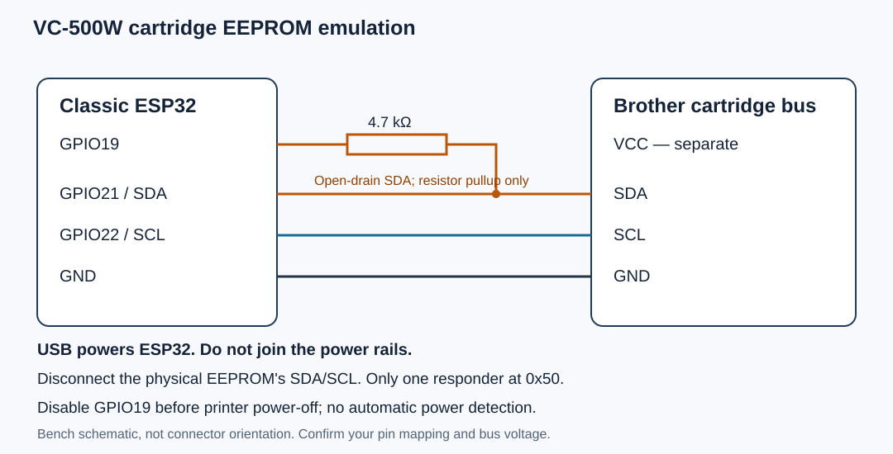
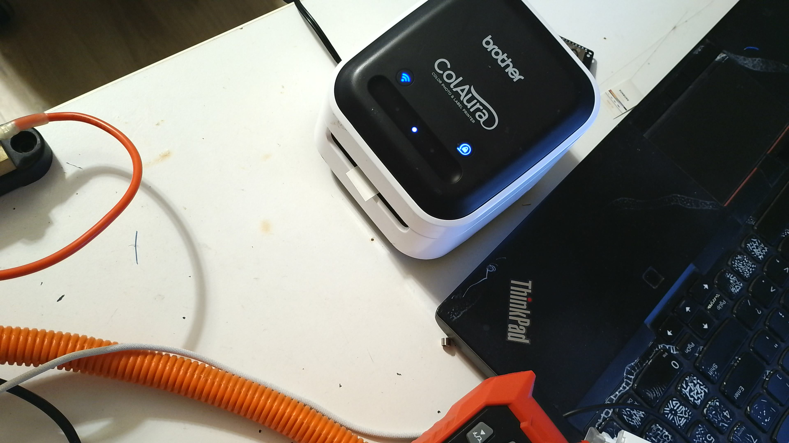
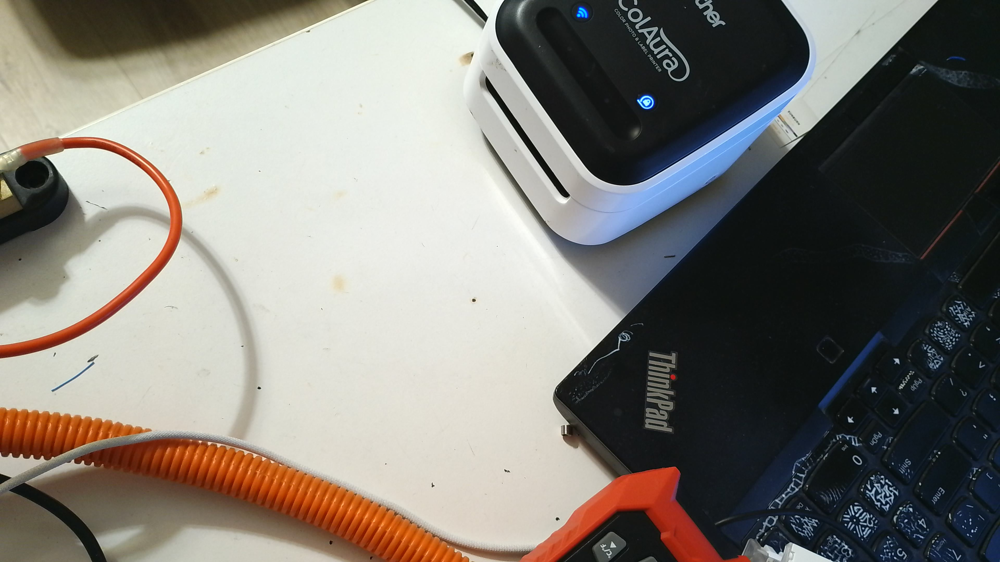

# Replacing the VC-500W cartridge EEPROM with an ESP32

This experiment adds an ESP32 between the printer's cartridge interface and our
software tools. The ESP32 answers as a 256-byte I²C EEPROM while the unmodified
printer receives normal print jobs over its existing WiFi connection.

**Result: twelve consecutive labels printed from our normal website, with
half-cuts and no emulator faults.** The printer read the emulated memory and
wrote back its usage counter and checksum. This is a working bench prototype,
not a demonstrated full-roll or power-loss-safe replacement.

| Read this next | Purpose |
| --- | --- |
| [Protocol and measured results](cartridge-protocol.md) | Addresses, transactions, checksums, evidence and limits |
| [Build and host tools](cartridge-build.md) | Pinned toolchain, firmware installation and command usage |
| [Development history](cartridge-history.md) | Failed approaches and the changes that led to V12 |
| [Firmware and tools](../cartridge/) | Source, tests and experiment interfaces |

## The problem

We wanted to print component labels reliably from our own application and use
the physical tape available in a cartridge. That exposed two separate problems:
the host must distinguish accepted print data from finished output, and the
printer must accept the cartridge's memory contents and subsequent usage writes.

A cartridge error does not identify the cause. During this work we encountered
bad electrical contact, a damaged connector, a real paper jam and an empty roll.
Those mechanical failures had to be fixed before an emulator result meant
anything. A changed EEPROM count cannot repair a jam or create more tape.

We first read and restored a physical cartridge EEPROM on an isolated bus. We
then replaced the EEPROM's SDA/SCL connection with an ESP32 responder. The
printer and website did not need a special print command for emulation.

## What we built

- Passive sampling firmware and a decoder to investigate the cartridge bus.
- An isolated EEPROM reader/writer with image hashes, checksums and readback.
- A hardware I²C slave implementation for the original ESP32, including bounded
  interrupt handling, page writes and terminal-NACK read accounting.
- USB management and authenticated WiFi updates, so routine firmware updates
  no longer require holding the board's BOOT button.
- A GPIO-controlled resistor pullup that lets the bench setup trigger a new
  cartridge scan without restarting the printer.
- Host tools and offline tests that preserve exact images and expose faults
  instead of silently resetting counters or retrying uncertain prints.

The current entry point is
[`eeprom_emulator_v12`](../cartridge/firmware/eeprom_emulator_v12/).
Earlier versions are retained to explain the investigation; they are not
equivalent alternatives to V12.

## Wiring used on the bench

The tested board is a classic ESP32-D0WDQ6 with 4 MiB flash, running at 240 MHz.
The tested printer reports firmware `2022071322`; the physical tape is CZ-1003,
nominally 19 mm / 3/4 inch. Other ESP32 families, printer revisions and cassette
variants have not been qualified by this experiment.

| ESP32 connection | Printer connection / function |
| --- | --- |
| GPIO21 | Cartridge SDA; open-drain response |
| GPIO22 | Cartridge SCL; printer supplies the clock |
| GND | Shared signal ground |
| GPIO19 through 4.7 kΩ | Switchable pullup to the SDA/GPIO21 node |
| USB | ESP32 power and management connection |
| ESP32 3V3/VCC | **Not connected to printer cartridge VCC** |

Disconnect the physical cartridge EEPROM's SDA and SCL from this bus before
enabling the emulator. There must be only one responder at address `0x50`.
The physical cassette and tape still need to be correctly installed.

The printer-side supply measured 3.26 V on this setup. Verify your own bus voltage
and pin mapping; do not infer connector orientation from the table. On the
physical memory IC we used pin 5 for SDA and pin 6 for SCL, but that is not a
universal connector numbering scheme.

**Disable GPIO19 before switching the printer off.** The prototype has no
automatic printer-power detector. Driving the resistor from a powered ESP32
while the printer is off can feed current into the printer. Do not join the two
power rails. The resistor is a weak pullup, not a direct GPIO-to-SDA drive.

## How the experiment progressed

### Establish a physical baseline

We repaired the connector and removed a small piece of debris from the paper
path. A restored physical EEPROM and a fresh roll then produced a label. This
separated paper-path failures from protocol failures.

The isolated reader/writer required an exact preimage and verified complete
postreads. Its operation is different from emulation: never enable an EEPROM
master tool while the printer is also driving that bus.

### Make the ESP32 behave like the memory

The emulator serves reads from a supplied 256-byte image, models 16-byte pages
(the observed live printer writes were eight-byte chunks), and records writes only after a qualified transaction
end. It does not manufacture a generic cartridge identity or silently repair
unknown bytes. Supply and review an image from your own compatible cartridge.

Early versions exposed two useful errors. Counting read bytes that were merely
prefetched into the peripheral FIFO overstated what the printer received; the
later implementation accounts for bytes actually removed by terminal NACK.
For writes, byte interrupts and the final peripheral FSM state were insufficient
to decide whether the observed STOP was valid. V12 uses the reviewed FIFO and
bus-idle conditions and preserves bounded committed/rejected write evidence.

Those changes were checked with native tests before hardware use. See the
[history](cartridge-history.md) and [protocol](cartridge-protocol.md) for the
actual failure boundaries and remaining unqualified cases.

### Rescan without a printer restart

Removing a physical cassette did not consistently trigger a fresh scan when the
memory was wired independently of it. We eventually drove a 4.7 kΩ SDA pullup
from GPIO19, allowing the host to disable the pullup, prepare the responder, then
enable it deliberately while the printer was powered.

The emulator served a full 256-byte read during initialization, and the printer
progressed through `INITIALIZE → LOADING PAPER → READY FOR PRINT`.
This demonstrates a rescan on this setup. It
does not establish that every presence switch or optical sensor has been
understood, or that GPIO19 alone handles every loading state.

### Print through the normal application

The user pressed Print in our website. Our application sent sequential normal
print jobs through its existing single connection owner. No special EEPROM
command was added to the website and no competing raw TCP connection was used.

Every job used one copy and half-cut mode, including the last label. The host
checked print activity followed by stable idle and no printer error before
continuing. A print-data acknowledgement alone is insufficient evidence.

## Photos from the actual tests

The earlier V11 calibration produced physical output. This view shows the back
of that piece, not a legibility check of its front. V11 subsequently rejected a
usage write; that failure is retained in the history rather than presented as a
fully successful cartridge transaction.

After the V12 run, the user reported finishing the prints and the camera showed
the output cleared. These are real bench images; the wiring diagram above is a
schematic, not a photograph of the installed electrical connections.

## What the twelve-label run proves

All twelve jobs were reported completed and verified by the host, and the user
reported finishing the prints. Individual device-verification times were about
21–32 seconds; the slower first job included a preheat stage.

The ESP32 remained active with fault code zero. Across the run its generation
advanced from 1 to 25: 24 RAM page commits. Received and transmitted byte counts
matched twelve observed-pattern cycles of two eight-byte writes and two
sixteen-byte reads. All three checksum regions matched in the final image.
Only the counter bytes at `0xE8–0xE9` and their checksum at `0xF6–0xF7` changed.

The [public evidence summary](../cartridge/evidence/) contains aggregate results
without lab addresses, credentials, the full cartridge dump or customer parts.

## Limits and next work

The current implementation checkpoints nonvolatile memory through an explicit
STOP operation. **Writes during active emulation are in RAM.** The successful
run ended with live generation 25, durable generation 1 and `dirty=true`. Do not
unplug the ESP32 and assume those updates are saved. A future persistence design
must preserve bus timing and handle interrupted writes; that has not been
demonstrated here.

STOP also disables the pullup and can initiate cartridge unloading. Finish,
manually cut and remove the output strip before intentionally detaching the
emulator. Preserve and compare the complete image when checkpointing.

Other open work includes full-cartridge endurance, power-loss recovery, more
malformed transaction cases and other media/firmware variants. The printer's
reported remaining length and the EEPROM counter interpretation have small
unresolved differences; the source evidence preserves both values. We have not
demonstrated printing an entire roll or solved those differences by inventing
counter bytes.

Half-cut labels can stay attached at the output. Our normal workflow is a strip
with half-cuts between labels, followed by a manual final cut and removal. Loose
paper at the slot is not by itself proof of a jam; use current printer status
and physical inspection together.

## Reuse and attribution

This material uses the repository's existing [license](../LICENSE), including
its noncommercial restrictions. No Brother firmware archive, extracted vendor
binary, downloaded toolchain, WiFi credentials or complete device flash image
is included. Install upstream dependencies separately and retain their licenses.

The build instructions identify the source and toolchain we tested. The firmware
is a research prototype; a successful twelve-label run does not turn older
versions or untested hardware into a qualified replacement.
