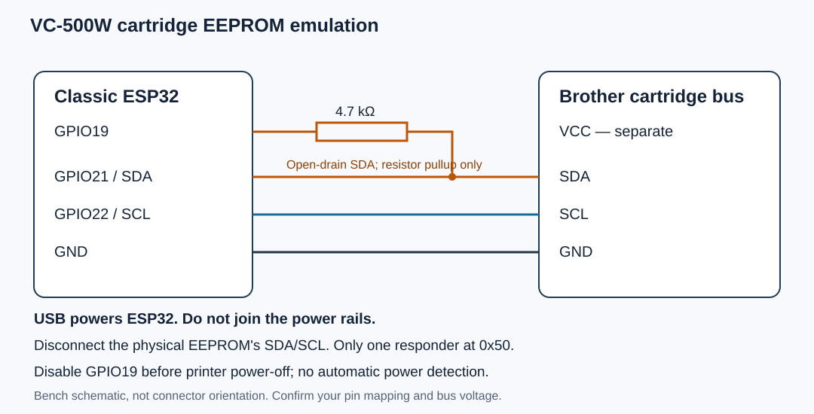

# Cartridge EEPROM protocol and ESP32 observations

On 18 November 2026 UTC (the evening of 17 November PST), a classic ESP32 replaced the cartridge EEPROM in one
Brother VC-500W and supported **12 consecutive, user-submitted half-cut labels**.
The printer completed all 12 jobs, and the ESP32 accepted the resulting memory
updates without a reported transport fault. This is a measured result for the
configuration below; complete-roll endurance remains untested.

This cartridge I²C interface is separate from the printer's XML/JPEG interface
over Wi-Fi or USB. The existing printer driver still submits the images.

## Tested configuration

| Item | Observed configuration |
| --- | --- |
| Printer | Brother VC-500W, firmware `2022071322` |
| Media | CZ-1003, nominal 19 mm × 5 m ZINK roll |
| Controller | Classic ESP32 DOIT DevKit V1, 240 MHz |
| Software | Arduino-ESP32 `2.0.17`, ESP-IDF `4.4.7` |
| Emulator | `i2c-eeprom-emulator-v12` |
| Address | 7-bit `0x50`; wire address bytes `0xA0` / `0xA1` |
| Memory | 256 bytes, one-byte pointer, 16-byte page model |
| Bus timing | Approximately 100 kHz in captured printer-to-physical-chip traffic |

The original chip's behavior is compatible with the relevant
[ST M24C02-R interface](https://www.st.com/resource/en/datasheet/m24c02-r.pdf).
This does not independently authenticate the chip marking or qualify every
M24C02 timing and power-loss behavior in the ESP32 implementation.

## Wiring used in this experiment



| Printer signal | ESP32 connection | Role |
| --- | --- | --- |
| SDA | GPIO21 | Hardware I²C slave, open-drain output and input |
| SCL | GPIO22 | Input only; printer remains the clock master |
| Ground | GND | Common signal reference |
| Cartridge VCC | **No connection to ESP32 VCC** | Supply rails remain separate |
| SDA pull-up | GPIO19 → **4.7 kΩ** → SDA/GPIO21 | GPIO19 HIGH enables the pull-up; input/high-impedance disables it |

Every physical cartridge EEPROM was disconnected from printer SDA/SCL before
enabling the ESP32 responder. This is **replacement of the sole `0x50` device**,
not transparent passthrough or a parallel connection to a live cartridge chip.
The ESP32 was USB powered. GPIO19 must be disabled before the printer is powered
off: the firmware has no automatic printer-power detector or backfeed protection.
GPIO19 OFF never drives LOW. Internal bus pull-ups are disabled.

Changing the pull-up from OFF to ON, with the responder prepared, caused a fresh
cartridge initialization without restarting the printer. Turning it OFF can
trigger unloading. Remove the completed strip and finish printing before an
explicit stop; a hanging half-cut strip alone does not establish a jam.

## Transaction model

The captured normal random read uses a pointer write followed by a repeated START:

```text
START  A0 ACK  pointer ACK  repeated-START  A1 ACK
       data ACK ... final-data NACK  STOP
```

The model preserves the pointer across the repeated START, separates prefetched
transmit bytes from consumed bytes, and wraps sequential addressing after `FF`.
Write data is latched within a 16-byte page, wrapping the low four address bits.
A qualified write STOP commits the latch; a repeated START does not commit it.
Native model tests exercise these rules. The live qualification covers the
printer's observed normal full read, 16-byte reads and eight-byte writes.

For the normal usage update, the physical-chip trace showed:

```text
read 16 bytes from E8
write 8 bytes at E8..EF, STOP
write 8 bytes at F0..F7, STOP
read back 16 bytes from E8
```

Those writes cross a 16-byte page boundary. The emulator mirrors the bytes the
printer sends, including intermediate states in which the RW2 CRC is temporarily
invalid. It does not repair the CRC, reset the remaining count or change the
cartridge identity automatically.

The ESP32 adapter uses an IRAM interrupt handler and internal RAM. Stock Arduino
`Wire` callbacks are deferred and do not expose enough framing for this model.
Empirical revisions were required: a zero RX threshold caused an empty-FIFO IRQ,
RX data must be drained before clearing its watermark flag, and the observed
byte-interrupt count was unsuitable as a count of bytes delivered to the master.
V12 uses FIFO accounting at the terminal NACK for the qualified reads and sampled
RX FIFO/ACK-state coverage plus an idle STOP for the qualified writes.

## Remaining count and CRC regions

Static analysis of a public Brother/ZINK firmware package, followed by actual
chip reads and printer updates, established the fields used here. The package
revision was `2022071302`, which differs from the tested printer's `2022071322`.
Unobserved fields must not be treated as a complete cartridge specification.

| Field / region | Bytes | Interpretation used here |
| --- | --- | --- |
| Initial count | `60..61` | Little-endian `uint16` |
| Remaining count | `E8..E9` | Little-endian `uint16` |
| R0 CRC input / stored CRC | `00..AD` / `AE..AF` | CRC stored little-endian |
| RW1 CRC input / stored CRC | `D0..E5` / `E6..E7` | CRC stored little-endian |
| RW2 CRC input / stored CRC | `E8..F5` / `F6..F7` | CRC stored little-endian |

The CRC is **CRC-16/IBM-SDLC (X-25)**: reflected polynomial `8408`, initial `FFFF`,
final XOR `FFFF`; `123456789` produces `906E`. A matching CRC demonstrates data
consistency, not authentication or remaining physical paper.

For the observed product-revision-2 format, the archived engine interprets count
units as **1/32 inch**. The initial count `6299` nominally represents 4999.83125 mm.
Other product formats, including a wristband branch, use different units.
Printer status also rounds through a separate representation; status millimeters
must not be used to invent missing EEPROM bytes or claim a measured tape length.

## Twelve-print result

The user printed a selected subset of saved component labels from the normal
website. These were 12 single-copy, vivid, half-cut jobs, rather than a new
11-label zener batch or the whole original 30-label list. The user reported
finishing, and all 12 owner results recorded print activity followed by settled
idle and successful completion. Reported job durations were approximately
21–32 seconds. The final fresh printer status was `IDLE / SUCCESS / NONE`.

| Observation | Before | After / change |
| --- | --- | --- |
| Remaining word | `1870` = 6256 | `16BD` = 5821 |
| Live image generation | 1 | 25: 24 page commits |
| RX bytes | 1 | 241: +240 |
| Completed TX bytes | 256 | 640: +384 |
| STOP / terminal NACK events | 1 / 1 | 49 / 25: +48 / +24 |
| Emulator faults and reported FIFO / invalid-STOP errors | 0 | 0 |
| R0 / RW1 / RW2 CRC | Valid | Valid: `3751 / 98CB / B2AD` |
| Durable generation | 1 | **1: active writes were still RAM-only** |

The aggregate is exactly consistent with 12 normal cycles, each containing two
eight-byte page writes and two 16-byte reads. Only four final image bytes changed:
`E8:70→BD`, `E9:18→16`, `F6:AA→AD`, `F7:25→B2`. This is not a payload log of all
24 writes: the bounded diagnostic ring retains only the latest four page records
and is exported only when inactive.

The last job reported 4620.514 mm, while a later fresh status reported 4613.656 mm.
The cause of that 6.858 mm difference is not established by these snapshots.
It is preserved as a discrepancy rather than converted into an invented write.
See the [aggregate validation record](../cartridge/evidence/v12-twelve-print-validation.json)
and [redaction/provenance notes](../cartridge/evidence/README.md).

## Persistence and remaining qualification

An I²C ACK and a committed RAM page are not durable NVS storage. During active
emulation, Wi-Fi, OTA and flash writes are suspended. Explicit STOP detaches the
responder before checkpointing; only a successful checkpoint with identical full
postimage, equal live/durable generations and a closed clean session establishes
that saved state. Boot is passive, and an interrupted active-session marker
reports possible loss of acknowledged volatile writes. There is no automatic
counter reset or silent recovery to a supposedly current older image.

The final twelve-print observation was **active, live generation 25, durable
generation 1, dirty true**. No power-loss persistence claim is made from it.
Earlier failed prototypes lost an unlogged usage write and had an uncertain
volatile reset window; the successful run does not reconstruct those histories.

Complete 5 m roll use, end-of-roll sensing, arbitrary bus masters, 400 kHz,
malformed mid-byte STOP behavior, all short-read/shifter cases and EEPROM-like
write-cycle busy timing remain unqualified. Paper/mark sensors still exist; a
counter change is not proof of bypassing physical media-end behavior.

## Primary sources

- [ST M24C02-R datasheet](https://www.st.com/resource/en/datasheet/m24c02-r.pdf)
- [Espressif ESP32 technical reference manual](https://documentation.espressif.com/esp32_technical_reference_manual_en.pdf), I²C chapter; observed silicon behavior is distinguished above from conflicting register comments.
- [Arduino-ESP32 2.0.17 slave implementation](https://github.com/espressif/arduino-esp32/blob/2.0.17/cores/esp32/esp32-hal-i2c-slave.c)
- [ESP-IDF 4.4.7 I²C driver](https://github.com/espressif/esp-idf/blob/v4.4.7/components/driver/i2c.c)
- [Public Brother/ZINK firmware archive](https://cdn.zinkapps.com/brotherupgrade-2022071302.tgz), SHA-256 `8a307f78b9aec092910e0d2089e077ca00f864def08d101ca3b936cff15e4312`; vendor binaries are not included in this repository.
